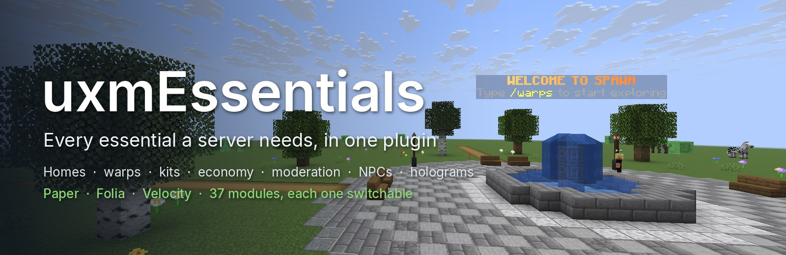
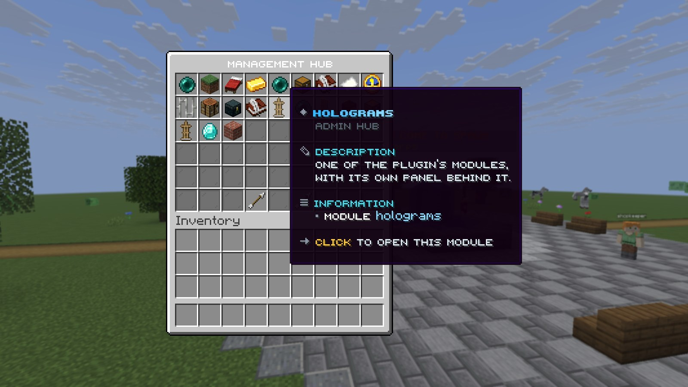

<p align="center">
  
</p>

<p align="center">
  <a href="https://github.com/UXPLIMA/uxm-essentials/releases/latest"></a>
  <a href="https://github.com/UXPLIMA/uxm-essentials/actions/workflows/ci.yml"></a>
  
  
</p>

**uxmEssentials** is the essentials suite for Paper and Folia: 37 modules in one jar, from homes, warps, kits and
an economy to moderation, region protection, holograms and NPCs. Each module has its own config file and its own
switch, so a server takes only what it needs and leaves the rest off.

Nothing else is required: uxmLib is inside the jar. Vault and PlaceholderAPI are used when present.

**[Download](https://github.com/UXPLIMA/uxm-essentials/releases/latest)** ·
**[Manual](https://docs.uxplima.com/minecraft/plugins/uxmessentials)** ·
**[Report a bug](https://github.com/UXPLIMA/uxm-essentials/issues)**

## What it does



| Area | Modules |
|---|---|
| **Getting around** | Teleport (`/tpa`, `/back`, `/rtp`, `/spawn`), homes, warps, player warps, worlds |
| **Money and items** | Economy with several currencies, `/sell` and `/worth`, kits, vaults, trades, villager trade rules |
| **Chat and people** | Private messages, mail, broadcasts, AFK, nicknames, `/whois`, votes and vote parties |
| **Staff** | Bans, mutes, jails and warnings, staff mode and staff chat, vanish, inventory rollback, command control |
| **The server's look** | Scoreboard, tab list, boss bar, name tags, holograms, NPCs, poses, skins, custom menus and commands |
| **Protection** | Guard: regions with rules per action and role, templates and a WorldGuard importer |
| **Player state** | `/fly`, `/heal`, `/feed`, `/gamemode`, `/speed`, `/endersee` and the rest of the classics |

### Holograms and NPCs without another plugin

Holograms are native Display entities: text, items and blocks, scaled, turned and shown to whom you choose.
NPCs are fake players with any skin, a click command and a pose. Both are made in game with `/hologram` and
`/npc`, or in their menus.

### An economy other plugins can use

Several currencies, payments, bank deposits and loans, tax, `/sell` with item worths and a balance top list. It
publishes itself to Vault, so every shop and job plugin pays in it.

### One server or a network

Homes, warps, the economy and vaults stay in step across servers. Add the Velocity jar on the proxy, or the
Redis jar with no proxy at all. Optional jars bring a Discord bridge and a REST and WebSocket API.

### Moving in from another plugin

`/uxmess import` reads bans, mutes and warnings from LiteBans and player warps from AxPlayerWarps. Guard imports
WorldGuard regions with a dry run and an undo.

Every line a player reads is in `messages/`, in twelve languages: English, Turkish, German, Spanish, French,
Portuguese, Russian, Ukrainian, Polish, Japanese, Korean and Chinese.

## Install

1. Download `uxmEssentials-<version>.jar` from the [latest release](https://github.com/UXPLIMA/uxm-essentials/releases/latest)
   and check it against `SHA256SUMS`.
2. Put it in `plugins/` and start the server.
3. Turn modules on and off with `enabled` in `plugins/uxmEssentials/modules/<module>/config.conf`, then run
   `/uxmess reload`. `/uxmess doctor` checks the setup.

Paper or Folia 26.2 or later, and Java 25. SQLite out of the box; MySQL, MariaDB and PostgreSQL with the
`storage` block in `config.conf`. The files it writes are listed in [docs/user/reference.md](docs/user/reference.md).

## Build

```sh
./gradlew build       # format check, static analysis, the shaded jar and its check
./gradlew runServer   # a local Paper server with the plugin
```

More in [docs/README.md](docs/README.md). Every picture on this page was taken in game on a test server.

By [UXPLIMA](https://github.com/UXPLIMA) · GPL-3.0
